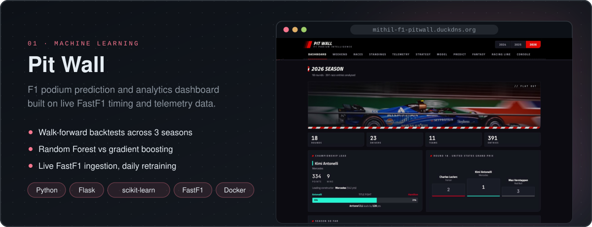
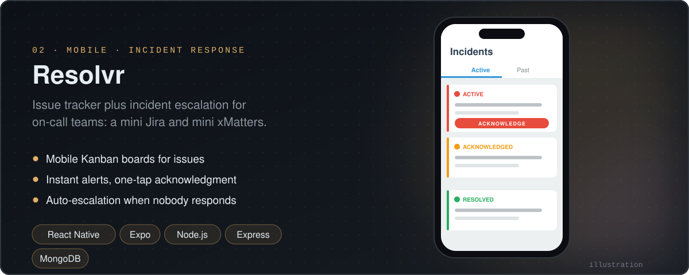
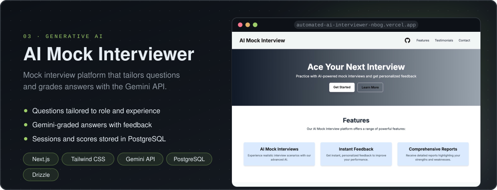

<!-- Visuals in assets/ are generated by assets/generate.py; the stats card and snake are rebuilt daily by .github/workflows/snake.yml -->

  

  
  
  
  
  

## About

  

Computer Science undergrad at **NIT Delhi** who builds things end to end, from Spring Boot microservices to ML pipelines to full-stack web apps.

- Software Engineering Intern at **HSBC** (Summer 2026)
- Contributed Mockito unit tests to [uber-doma-architecture](https://github.com/YeamimHossainSajid/uber-doma-architecture/pull/995) (merged)
- Deputy General Secretary, **Google Developer Student Clubs**, NIT Delhi

  

## Experience

### Software Engineering Intern · HSBC

**Jun 2026 – Jul 2026**

- Enhanced an internal **TDS chatbot** with better intent recognition, response generation and workflow automation for employee tax queries
- Integrated the **Vidura microservice** into the GPS portal (service and API integration, environment configuration)
- Supported the **Panorama** application on **Spring Boot + GCP** through production bug fixes and code-quality improvements

## Selected projects

<a href="https://github.com/Mithilbatra/F1_ML_project"><b>Code</b></a> &nbsp;·&nbsp; <a href="http://mithil-f1-pitwall.duckdns.org"><b>Live demo</b></a>

<a href="https://github.com/Mithilbatra/Resolvr---An-Issue-Tracker-Incident-Escalation-System"><b>Code</b></a>

<a href="https://github.com/Mithilbatra/automated_ai_interviewer"><b>Code</b></a> &nbsp;·&nbsp; <a href="https://automated-ai-interviewer-nbog.vercel.app"><b>Live demo</b></a>

More of my work lives in **[openCodes](https://github.com/Mithilbatra/openCodes)**.

## Tech stack

<table>
  <tr><td><b>Languages</b></td><td>Java · Python · C · C++ · JavaScript · TypeScript</td></tr>
  <tr><td><b>Frameworks</b></td><td>Spring Boot · Next.js · React · Node.js · Flask · Tailwind CSS · OpenCV</td></tr>
  <tr><td><b>Databases</b></td><td>PostgreSQL · MySQL · MongoDB</td></tr>
  <tr><td><b>Cloud &amp; DevOps</b></td><td>GCP · AWS · Azure · Docker · Git · GitHub Actions</td></tr>
  <tr><td><b>AI / ML</b></td><td>scikit-learn · Pandas · Machine Learning · Deep Learning</td></tr>
  <tr><td><b>Core</b></td><td>REST APIs · Microservices · Webhooks · DSA · OOP · Design Patterns</td></tr>
</table>

  

## Achievements & leadership

- **99.467 percentile** in JEE Main (top 0.5% nationwide) · JEE Advanced **AIR 5376**
- **Gold** at MST Tournament 2025, NIT Jaipur
- **Quarter-finalist**, Flipkart Grid and L'Oréal Sustainability Challenge
- **Deputy General Secretary**, Google Developer Student Clubs, NIT Delhi
- **Executive**, Training and Placement Cell, NIT Delhi
- **800+** problems solved across coding platforms

  
<b>Certifications</b>

   

- **Cassandra** (Udemy): distributed databases, fault tolerance and horizontal scaling
- **Azure Services** (Microsoft): designing, deploying and managing cloud solutions
- **C++ Proficient Practitioner** (Edchart): STL, memory management and optimisation

  
<b>Education</b>

   

| Institution | Qualification | Year | Score |
|:--|:--|:--|:--|
| National Institute of Technology, Delhi | B.Tech, Computer Science and Engineering | 2023 – present | CGPA 8.93 |
| Stepping Stones Sr. Sec. School, Chandigarh | CBSE Class XII | 2023 | 91.8% |
| Seth Anandram Jaipuria School, Vasundhara | CBSE Class X | 2021 | 94.6% |

  
<b>Relevant coursework</b>

   

Software Engineering · Database Management Systems · Machine Learning · Artificial Intelligence · Natural Language Processing · Computer Vision · Data Mining · Pattern Recognition · Quantum Computing · Probability and Statistics · Optimization Techniques

## Activity

  

  
  

  <picture>
    <source media="(prefers-color-scheme: dark)" srcset="https://raw.githubusercontent.com/Mithilbatra/Mithilbatra/output/snake-dark.svg" />
    <source media="(prefers-color-scheme: light)" srcset="https://raw.githubusercontent.com/Mithilbatra/Mithilbatra/output/snake.svg" />
    
  </picture>

  

<!-- this is a comment -->
