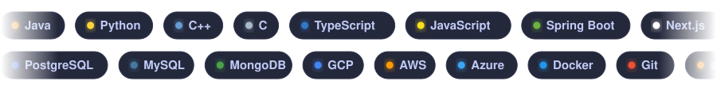

<!-- Animated visuals live in assets/ and are generated by assets/generate.py -->

  

  

  
  
  
  

## 👨‍💻 About me

  

  🌱 Currently writing Mockito unit tests for <a href="https://github.com/YeamimHossainSajid/uber-doma-architecture"><b>uber-doma-architecture</b></a> &nbsp;·&nbsp;
  🏅 Deputy General Secretary, <b>GDSC NIT Delhi</b> &nbsp;·&nbsp;
  📫 <a href="mailto:mithil.batra05@gmail.com"><b>mithil.batra05@gmail.com</b></a>

## 📈 By the numbers

  

## 💼 Experience

<table>
  <tr>
    <td width="130" align="center" valign="top">
       
       
      Jun 2026 – Jul 2026
    </td>
    <td valign="top">
      <h3>Software Engineering Intern</h3>
      <ul>
        <li>Enhanced an internal <b>TDS chatbot</b> with better intent recognition, response generation and workflow automation for employee tax queries</li>
        <li>Integrated the <b>Vidura microservice</b> into the GPS portal (service and API integration, environment configuration)</li>
        <li>Supported the <b>Panorama</b> application on <b>Spring Boot + GCP</b> through production bug fixes and code-quality improvements</li>
      </ul>
    </td>
  </tr>
</table>

## 🚀 Featured projects

F1 podium prediction and analytics dashboard built on live FastF1 timing and telemetry data.

- Leakage-safe features with walk-forward backtesting across 3 seasons
- Random Forest vs gradient boosting, scored on Top-3 Hit Rate and PR-AUC
- Automated live ingestion and daily retraining, Dockerized

  
  
  &nbsp;&nbsp;

 

Incident management and alerting platform for on-call teams.

- Kanban incident workflow with manual and webhook/API-driven creation
- On-call scheduling, escalation policies and multi-channel notifications
- Incident timelines and runbooks in one place

  
  &nbsp;&nbsp;

 

Automated mock interview platform powered by the Google Gemini API.

- Questions tailored by role, industry and experience level
- AI answer evaluation with personalised feedback
- PostgreSQL store for sessions, questions, answers and scores

  
  
  &nbsp;&nbsp;

More of my work lives in <a href="https://github.com/Mithilbatra/openCodes"><b>openCodes</b></a>.

## 🛠️ Tech stack

  

<table>
  <tr><td><b>Languages</b></td><td></td></tr>
  <tr><td><b>Frameworks</b></td><td></td></tr>
  <tr><td><b>Databases</b></td><td></td></tr>
  <tr><td><b>Cloud &amp; DevOps</b></td><td></td></tr>
  <tr><td><b>AI / ML</b></td><td> &nbsp;   </td></tr>
  <tr><td><b>Tools</b></td><td></td></tr>
  <tr><td><b>Core</b></td><td>REST APIs · Microservices · Webhooks · DSA · OOP · Design Patterns</td></tr>
</table>

## 🏆 Achievements & leadership

<table>
  <tr><td>🎯</td><td><b>99.467 percentile</b> in JEE Main (top 0.5% nationwide) · JEE Advanced <b>AIR 5376</b></td></tr>
  <tr><td>🥇</td><td><b>Gold</b> at MST Tournament 2025, NIT Jaipur</td></tr>
  <tr><td>🏁</td><td><b>Quarter-finalist</b>, Flipkart Grid and L'Oréal Sustainability Challenge</td></tr>
  <tr><td>👥</td><td><b>Deputy General Secretary</b>, Google Developer Student Clubs, NIT Delhi</td></tr>
  <tr><td>📣</td><td><b>Executive</b>, Training and Placement Cell, NIT Delhi</td></tr>
  <tr><td>💡</td><td><b>800+</b> problems solved across coding platforms</td></tr>
</table>

  
<b>📜 Certifications</b>

   

- **Cassandra** (Udemy): distributed databases, fault tolerance and horizontal scaling
- **Azure Services** (Microsoft): designing, deploying and managing cloud solutions
- **C++ Proficient Practitioner** (Edchart): STL, memory management and optimisation

  
<b>🎓 Education</b>

   

| Institution | Qualification | Year | Score |
|:--|:--|:--|:--|
| National Institute of Technology, Delhi | B.Tech, Computer Science and Engineering | 2023 – present | CGPA 8.93 |
| Stepping Stones Sr. Sec. School, Chandigarh | CBSE Class XII | 2023 | 91.8% |
| Seth Anandram Jaipuria School, Vasundhara | CBSE Class X | 2021 | 94.6% |

  
<b>📚 Relevant coursework</b>

   

Software Engineering · Database Management Systems · Machine Learning · Artificial Intelligence · Natural Language Processing · Computer Vision · Data Mining · Pattern Recognition · Quantum Computing · Probability and Statistics · Optimization Techniques

## 📊 GitHub & LeetCode stats

  
  

  

  

  <picture>
    <source media="(prefers-color-scheme: dark)" srcset="https://raw.githubusercontent.com/Mithilbatra/Mithilbatra/output/snake-dark.svg" />
    <source media="(prefers-color-scheme: light)" srcset="https://raw.githubusercontent.com/Mithilbatra/Mithilbatra/output/snake.svg" />
    
  </picture>

  

